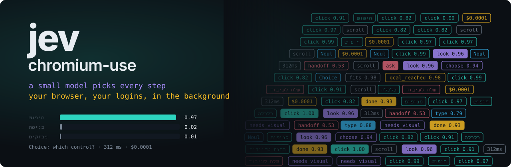
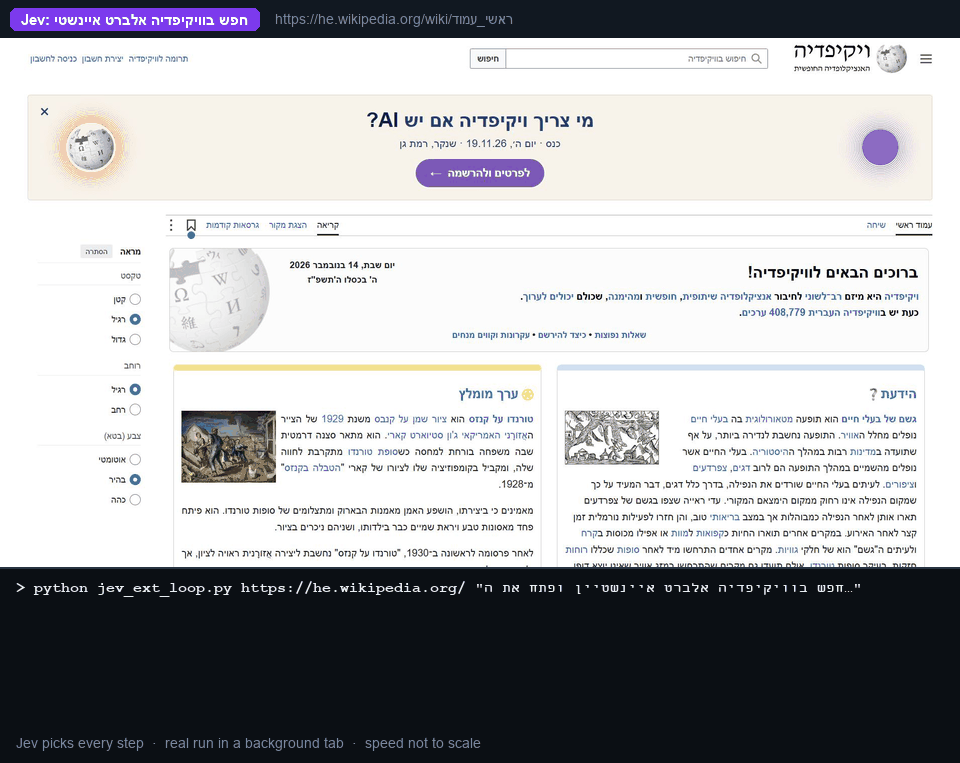

<p align="center">
  
</p>

<h3 align="center">A small decision model drives your browser, not a frontier LLM</h3>

<p align="center">
  <b>Your signed-in Chromium browser</b> · <b>a background tab</b> · <b>Hebrew-ready</b> · <b>about $0.0001 a step</b>
</p>

<p align="center">
  
  
  
  <a href="https://docs.typesafe.ai"></a>
  
  <a href="LICENSE"></a>
  
</p>

<p align="center">
  <a href="#quick-start">Quick start</a> ·
  <a href="#use-it-from-an-ai-agent">Use it from an AI agent</a> ·
  <a href="#how-it-works">How it works</a> ·
  <a href="#safety-rules">Safety rules</a> ·
  <a href="#calibration">Calibration</a> ·
  <a href="#compared-with-an-llm-that-reads-screenshots">Cost vs. screenshot LLMs</a> ·
  <a href="#risks">Risks</a>
</p>

---

You give a goal in plain language (Hebrew works). The loop reads the page's DOM, asks
[TypeSafe](https://docs.typesafe.ai)'s Jev which control to click or what to type, and acts, in
**your own signed-in Chromium browser** (Edge or Chrome), in a background tab inside a labeled tab
group, without opening a window or taking focus. A whole task costs a fraction of a cent; a
decision takes about a third of a second.

<p align="center">
  
  <br>
  <sub>A real run, recorded with <code>--record</code>: every frame is the loop's tab before the step, with the
  control Jev chose outlined. Content from Hebrew Wikipedia (CC BY-SA 4.0).</sub>
</p>

```text
> python jev_ext_loop.py https://www.ynet.co.il "חפש באתר כתבות על רפאל"

step 1  https://www.ynet.co.il/home/0,7340,L-8,00.html
  26 elements, decision 474ms, 2595 tokens, {'goal_reached': 0.04, 'fits': 0.98}
  -> click button: 'חיפוש'  (confidence 1.00)
step 2  ...
  -> type text field: 'חיפוש'  (search)
  text: 'רפאל' (conf 0.69)
step 3  ...
  -> done  (goal_reached=0.93)
cost: Jev 9363 input tokens = $0.00039
```

<div dir="rtl">

**בעברית, בקצרה:** סוכן דפדפן שבו מודל החלטות קטן וזול (Jev של TypeSafe) בוחר כל צעד במקום
מודל שפה גדול. הוא עובד בתוך הדפדפן שלך (Edge או Chrome) עם החשבונות המחוברים, בכרטיסיית רקע, ומבין אתרים
בעברית. כשצריך להסתכל על המסך, הוא מעביר צילום למודל שפה שרואה תמונות: לסוכן שמריץ אותו (Claude Code, Codex וכו') או ל-Claude דרך ה-API.

</div>

> **Status: prototype.** Built and tested on Windows 11 (ARM64) with Microsoft Edge 157; Chrome
> uses the same extension and code path but has not been tested. It has been
> calibrated on 153 labeled cases and used for one QA pass on a signed-in web app (navigation,
> sorting, form entry). That is all the real mileage it has. Read [Risks](#risks) before pointing
> it at a site where you are logged in.

## Quick start

```bash
git clone https://github.com/avi720/jev-chromium-use
cd jev-chromium-use
pip install -r requirements.txt
python jev_ext_loop.py --setup        # writes a token, prints the extension install steps
```

Load the `jev-bridge-extension` folder in `edge://extensions` or `chrome://extensions` (Developer
mode, then **Load unpacked**), set `TYPESAFE_API_KEY`, and run a goal:

```bash
python jev_ext_loop.py https://www.ynet.co.il "פתח את מדור הכלכלה"
```

## How it works

```text
jev_ext_loop.py  <── WebSocket on 127.0.0.1 ──>  Jev Loop Bridge (browser extension)
      │                                                   │
      │  one request per step                             │  acts only in the tab it opened
      ▼                                                   ▼
  TypeSafe Jev                                   background tab, in a tab group
```

Each step:

1. **Perceive.** The extension lists what a user could act on, with exact labels from the DOM,
   plus the visible text. No screenshots and no OCR, so right-to-left text and Hebrew arrive
   intact. Jev is shown the controls on screen and scrolls when what it needs is not there.
   Perception also sees controls up to three screens above or below (`--perception`, see
   [Cost](#cost)), and the loop scrolls to one when it is picked. The list reaches into
   open shadow roots (web components) and same-origin iframes. Each control comes with its state:
   a dropdown with its options and the one chosen now, a custom dropdown as "opens a list", a
   checkbox or radio as checked or not, a tab or segmented button as selected or not, a text field
   as empty or filled. What is typed in a field is never read, only whether it holds something.
2. **Decide.** One request to Jev asks several narrow questions about the same page at once:
   | question | type | what it settles |
   |---|---|---|
   | `kind` | Choice | click, type, scroll or done |
   | `element` | Choice | which control, out of everything on screen |
   | `goal_reached` | Noul | is the goal already met |
   | `fits` | Noul | does the goal belong on this page at all |
   | `wants_search` | Noul | is the goal a search by query |
   | `needs_visual` | Noul | does the goal need someone to look at the screen |
   | `field` | Choice | which field or dropdown to fill next |
3. **Plan.** Plain code (`plan()` in `jev_core.py`) turns those answers into one step,
   using fixed thresholds. Same answers, same step.
4. **Act**, wait for the page, repeat. The loop ends on `done`, on a hand-off, on a repeated
   action, or at the step limit.

Jev never writes text. When something must be typed, it **selects** it: from the phrases of your
goal (a search query) or from values you pass with `--value` (form fields). A dropdown is set the
same way: Jev picks one of its options.

### Values you give are placed by code

`--value "LABEL=TEXT"` is a fact, not a suggestion. Before Jev is asked anything, code finds the
field or dropdown whose label matches `LABEL` (ignoring `*` and `:`) and puts `TEXT` there, even
when the field already shows a default, such as today's date or a dropdown on its first option.
`LABEL` is the page's own label, in the page's language; a label that matches nothing on the first
page is reported, together with the labels that do exist.
For a custom dropdown (a button that opens a list) it opens the list and clicks the option with
that text.
A control that looks like it submits (see [Safety rules](#safety-rules)) is not clicked while any
of your values has not been placed. This rule exists because an earlier version let Jev decide
which fields to fill: it skipped two dropdowns and two prefilled date fields and submitted a trade
with the wrong direction and date.

### When a step needs eyes

Jev reads controls and text, so it cannot tell whether a chart renders, text overflows its box, or
colors are readable. When `needs_visual` is high, the loop takes a screenshot of its tab and hands
the look to someone who can see, chosen with `--visual`:

| `--visual` | who looks | needs |
|---|---|---|
| `agent` | whoever runs the loop: a coding agent with a vision-capable LLM (Claude Code, Codex, Gemini CLI, Cursor...), or you | nothing extra |
| `api` | Claude through the Anthropic API (`claude-opus-5-5`, see `visual.py`) | `ANTHROPIC_API_KEY` and API credits |
| `auto` (default) | the API when credentials exist, otherwise the agent | |
| `jev` | Jev itself answers fixed yes/no checks on the screenshot: readable, overlap, cut off, broken media, covered by a dialog | nothing extra; about $0.0002 a look |
| `off` | nobody; the loop never asks for a look | |

Either way the screenshot is taken through the extension's `debugger` permission, so the tab stays
in the background, even when the browser window is covered by other windows. The browser shows a "started
debugging this browser" bar for the second it takes.

**Agent mode: the loop and the agent take turns.** This is the chain to use if you run the loop
from a coding agent and have no API credits: the agent's own model, whichever LLM it is, does the
looking, inside the subscription you already pay for.

1. The loop saves the screenshot under `%TEMP%\jev-loop\screenshots\` and stops with
   `handoff to the agent: this step needs eyes. Look at the screenshot: <path>`.
2. The agent opens the image and writes what it sees, in a sentence or three.
3. The agent runs the loop again with the same goal, starting from the page the loop ended on
   (`final page:` in its output), with `--observation "<what it saw>"`. Jev reads the
   observation as part of the page's state and carries on: done, or the next click.

```bash
python jev_ext_loop.py https://example.app "check that the dashboard cards are readable"
# ... handoff to the agent: ... Look at the screenshot: C:\...\jev-loop\screenshots\20261114-163342-step1.jpg
python jev_ext_loop.py https://example.app "check that the dashboard cards are readable" \
    --observation "All ten cards are readable; one card's numbers are smaller than the rest."
# -> done
```

The [agent skill](#use-it-from-an-ai-agent) teaches an agent this exchange, and what to do at
every other hand-off.

**API mode: one command, no turns.** With `ANTHROPIC_API_KEY` set (or `--visual api`), the loop
sends the screenshot to Claude itself. Claude returns a summary, a list of visual issues with
severity, and whether the goal is met; the loop prints them, adds them to its history, and Jev
keeps choosing the actions. Each page state is looked at once. A look costs about $0.01 to $0.02
(one image plus a short JSON answer at Opus prices), roughly a hundred Jev steps. To use another
model, change `MODEL` in `visual.py`.

**Jev mode: yes/no checks for the price of a step.** Jev 1.14 reads images, so `--visual jev` asks
it narrow questions about the screenshot instead of asking for a description. It is cheap and
coarse. Tried on three screenshots, it caught a promo dialog covering the page (`covered` 0.99) but
also scored up to 0.6 on `overlap` and 0.5 on `cut_off` for clean pages, so a check only counts as
an issue at 0.7 (`ISSUE_AT` in `visual.py`). TypeSafe calls its image input "dreamer-ready", not
production-ready, so this mode is an option and not the default.

## Requirements

- Windows with a Chromium browser that supports Manifest V3 extensions and tab groups: Microsoft
  Edge (tested) or Google Chrome (same code path, not tested). `--browser` picks which one the loop
  starts when none is running.
- Python 3.12+
- A TypeSafe API key in the `TYPESAFE_API_KEY` environment variable
- Optional, for the visual hand-off: an Anthropic API key in `ANTHROPIC_API_KEY`

```bash
pip install -r requirements.txt
```

## Install

```bash
python jev_ext_loop.py --setup
```

This writes a random token to `jev-bridge-extension/token.js` and prints the steps:

1. Open `edge://extensions` (Edge) or `chrome://extensions` (Chrome)
2. Turn on **Developer mode**
3. Click **Load unpacked** and choose the `jev-bridge-extension` folder

Keep the folder where it is: the browser loads the extension from it on every start.

## Use it from an AI agent

The loop is built to be run by an AI coding agent (Claude Code, Codex, Gemini CLI, Cursor, or any
agent whose LLM can run shell commands and read images) as much as by hand. The agent writes the goal, runs the loop, and
handles what the loop cannot: it looks at screenshots when a step needs eyes, asks you before a
click that buys, sends or deletes, and writes any free text itself.

`skills/jev-browser/SKILL.md` is an [Agent Skill](https://agentskills.io): a plain Markdown file
that teaches the agent this: when to use the loop and when not to, which flags to pass, and what to
do at each kind of hand-off. Nothing in it is specific to one LLM. Every agent needs `JEV_HOME`,
the folder where you cloned the repository; then install the skill the way your agent reads
skills. For Claude Code:

```bash
# 1. Tell the skill where the repository is (a user environment variable on Windows)
setx JEV_HOME "C:\path\to\jev-chromium-use"

# 2. Copy the skill into your personal skills folder
mkdir -p ~/.claude/skills && cp -r skills/jev-browser ~/.claude/skills/
```

Restart Claude Code so it picks up the skill and the variable. Then ask for a task in your
browser in plain words, for example *"in my browser, open the dashboard and tell me the Profit
Factor"*; the agent loads the skill when the task fits its description. To share the skill with
everyone who works in a project instead, copy it into that project's `.claude/skills/` folder.

**Other agents.** Agents that support the Agent Skills format read the same folder from their own
skills directory (for Codex, `~/.agents/skills/`); see your agent's docs for where that is. For an agent that does not, add one line
to its instructions file (`AGENTS.md` for Codex and most others, `GEMINI.md` for Gemini CLI):
*"For tasks in my signed-in browser, follow `$JEV_HOME/skills/jev-browser/SKILL.md`."* The agent's
LLM needs to read images for the visual hand-off; every current coding agent's does.

**Optional: make it the default browser tool.** The agent may have other ways into a browser
(a browser extension of its own, a built-in browser pane) and picks between them on its own. If
you want this loop used whenever a task needs your signed-in browser, say so in your agent's
global instructions file (`~/.claude/CLAUDE.md` for Claude Code, `~/.codex/AGENTS.md` for Codex,
`~/.gemini/GEMINI.md` for Gemini CLI):

```markdown
## Browser tasks
- For any task in my own signed-in browser, use the `jev-browser` skill. Fall back to other
  browser tools only when it cannot do the step (free text, a page it cannot read) or I ask.
```

Leave it out if you would rather the agent choose per task.

What the agent does at each outcome:

| the loop ends with | the agent |
|---|---|
| `done` | checks the final page against the goal, then reports |
| `handoff to the agent ... screenshot` | opens the screenshot, describes it, runs again with `--observation` |
| `... looks like a commitment` | asks you, quoting the button; on your yes runs again with `--approve "<label>"` |
| low confidence, wrong page, `stall` | rephrases the goal or starts from a better page, or asks you |
| a cookie dialog, a credential field | tells you; those are yours |

## Usage

```bash
python jev_ext_loop.py <url> "<goal>" [options]
```

| option | effect |
|---|---|
| `--steps N` | step limit (default 8) |
| `--yes` | do not ask before typing. Commitment-looking clicks still ask |
| `--value "LABEL=TEXT"` | a value for the field or dropdown labeled `LABEL`; placed by code, repeatable |
| `--dry-run` | decide the first step and act on nothing |
| `--close-tab` | close the tab at the end (default: leave it open in its group) |
| `--show-page` | print the controls and text of the final page, for a report of what ended up on screen |
| `--screenshot [full]` | save a screenshot of the final page and print its path; `full` stitches the whole page, up to eight screens, also in apps that scroll inside an inner panel |
| `--text "PHRASE"` | what to type when it is not written word for word in the goal, such as a search query in the site's language; when given, the loop types only these (and `--value`) phrases; repeatable |
| `--approve LABEL` | click a commitment-looking control whose label contains `LABEL` without asking: the yes you gave for that one control; repeatable |
| `--allow-commits` | click any commitment-looking control without asking. Only for a test account |
| `--reload-extension` | make the browser reload the extension after its files were edited (no url or goal needed) |
| `--perception MODE` | `onscreen` (default), `two-pass` or `full`: how much of the page Jev sees (see [Cost](#cost)) |
| `--browser B` | `edge`, `chrome` or `auto` (default): which browser to start when none is running |
| `--record FOLDER` | save a screenshot and the decision of every step; `docs/make_gif.py` turns it into a GIF |
| `--hide-overlays` | hide a dialog that covers the page instead of asking you (see below) |
| `--min-conf X` | element confidence below which the loop hands off (default 0.6) |
| `--visual MODE` | who looks when a step needs eyes: `auto`, `agent`, `api`, `jev` or `off` (see above) |
| `--observation TEXT` | what someone saw on the screen in an earlier run; repeatable |

If no browser is running, the loop starts one normally (Edge if installed, otherwise Chrome), so it
opens with your own tabs. The extension looks for the loop every 30 seconds, so the first
connection can take that long. Every run ends with a `summary: {...}` line (outcome, decisions,
tokens, cost, final URL) for scripts and agents to read.

### When the loop stops and hands off

A hand-off is the loop saying "this one is yours". It happens when:

- no control is chosen with enough confidence (it prints the top candidates),
- the goal does not seem to belong on the page (`fits` is low),
- the chosen control reads like a commitment (see [Safety rules](#safety-rules)),
- the target is a password, card or ID field,
- a dialog covers the page,
- a step needs eyes in agent mode (the screenshot path is printed; see above),
- one of your `--value` labels matches no field, or its value is not one of the dropdown's options.

### Cookie and consent dialogs

On a signed-in profile a consent wall is rare: it shows up on a site you have not visited, or
after its cookies were cleared. Answering it is a decision about your consent, so by default the
loop does not touch it. It brings the tab to the front and waits for you to answer the dialog,
then continues. With no terminal to ask in, it hands off.

If you would rather not be interrupted, `--hide-overlays` hides the covering element without
clicking anything in it. No consent is given, but the heuristic is crude (any fixed element
covering more than half the viewport) and can hide a legitimate dialog. To make hiding the
default, or to change the detection, see `Tab.perceive` in `jev_ext_loop.py` and `hideOverlays`
in `jev-bridge-extension/background.js`.

## Safety rules

These are code, not model judgment:

- **Only its own tab.** The extension refuses any command for a tab it did not open.
- **Commitment labels always ask.** A control whose label reads like buy, pay, order, send,
  submit, delete, cancel, confirm, agree, publish, save, sign up, sign out and so on (English and
  Hebrew) is never clicked without a yes from you, even with `--yes`. The rule is the `COMMIT`
  pattern in `jev_core.py`.
- **A surer pick for a riskier click.** A commitment-looking click needs Jev's confidence at 0.9
  or more (`COMMIT_CONF`), against 0.6 for any other click, and this holds even with `--approve`
  or `--allow-commits`, except that an `--approve` naming that control settles which control is
  meant. Below it the loop hands off.
- **No credentials.** Password, card-number, CVV and ID fields are never typed into.
- **Typing asks first**, unless `--yes`.
- **Only chosen text is typed.** The loop can type phrases from your goal, `--text` or `--value`,
  nothing else. A page cannot make it type text of its own.
- **One run at a time.** The extension serves one run; a second run stops with a clear message
  instead of taking over the first one's tab.
- **Your values before any submit.** A commitment-looking control is not clicked while a
  `--value` you gave has not been placed.
- **The bridge needs the token.** The extension acts only for a local server that presents the
  token from `token.js`; the server accepts only a connection from a browser extension.

## Calibration

`calibration/` holds the evidence for the thresholds: 17 saved Hebrew pages (news, stores,
government, health, university, Wikipedia) and 153 goals with known answers. The loop pins the Jev
version it was calibrated on (`JEV_MODEL = "jev-1.14.0"` in `jev_core.py`), so a new Jev release
cannot change its behavior unnoticed: re-run the calibration before moving to a newer one.

```bash
python calibration/collect.py     # save pages through the extension (public pages only)
python calibration/run.py         # ask Jev once per case and print the report
python calibration/run.py --report
python calibration/commit_words.py [--jev]
```

Result with the thresholds in use (`MIN_CONF=0.6`, `DONE_AT=0.8`, `FITS_AT=0.5`,
`SEARCH_AT=0.7`, `SEARCH_UNLESS=0.9`, `VISUAL_AT=0.7`), latest run:

| kind of case | n | right | stopped | not right |
|---|---|---|---|---|
| click a control | 118 | 108 | 0 | 10 |
| type a search | 8 | 8 | 0 | 0 |
| goal already met | 7 | 7 | 0 | 0 |
| nothing on the page fits | 8 | – | 8 | 0 |
| needs eyes (visual) | 12 | 12 | 0 | 0 |

- Of the 10 "not right" click cases, 9 took another reasonable route: in 5 the loop typed the goal
  into the site's search box where a direct link existed, and in 4 it declared the goal met on a
  page that arguably already showed the answer (a featured article on the home page it was asked
  to find).
- **One wrong click**: "enter my personal area" on the National Insurance site picked "order a code
  for the personal site", at confidence 0.53, 0.61 and 0.73 in three runs. It sits near the line
  and moves between runs. The commitment rule flags that label ("הזמנת"), so the loop would have
  asked before clicking it.
- Run to run, the counts move by one or two cases: the same set gave 110 right clicks in one run
  and 108 in the next.
- `needs_visual` separated cleanly: the 12 visual goals scored 0.84 to 0.98, and none of the other
  141 scored as high as 0.3.
- Between 0.3 and 0.6, `MIN_CONF` barely matters. Raising it to 0.9 stops 25 cases instead of 8
  and prevents one wrong step, so confidence alone is a weak guard.
- What mattered was the `fits` question. Before it, a goal that had nothing to do with the page
  ("order a pizza" on a news site) got a confident click on "search" or "home", up to 0.95. With
  it, all 8 such cases stop.

**Commitment wording.** The first version of the rule caught 85 of 202 commitment labels and
flagged look-alikes ("מבצעים" for "בצע", "מחקר" for "מחק"). The current rule catches 202 of 202
on that list and leaves 60 of 61 benign labels alone; on 534 real labels from the saved pages it
flags 19.

Read these numbers with their limits:

- The thresholds and the `fits` question were tuned on the same cases they are reported on.
  There is no held-out set, so expect somewhat worse on new sites.
- One live run of a "nothing fits" goal scored `fits=0.44`, close to the 0.5 line.
- The pages are signed-out home and listing pages, saved before the loop could see controls
  outside the viewport. Carts, checkouts, inboxes and settings pages are not in the set.
- Each case is a single decision. Multi-step runs were tested on a handful of goals only.
- Dropdowns, checkboxes, row context, offscreen controls, shadow DOM, iframes and the `--value`
  rule are not in the calibration set; each was tested on a few live pages only. The agent mode of the visual hand-off was tested end to end; API
  mode was tested up to the screenshot, since no API key was available.
- The word lists for the commitment rule were written by hand, by the same author as the rule.

## Risks

1. **A wrong click on a site where you are signed in.** This is the real one. A mistake there
   can send, delete or buy. The guards above reduce it and do not remove it: the commitment
   rule reads labels, so an icon-only button or an unusual wording gets past it. Use the loop
   for navigation, search and reading; do not give it goals that end in an irreversible action.
2. **Page content goes to TypeSafe, and screenshots to an LLM provider.** Every step sends the URL,
   title, up to 60 blocks of visible text and the control labels of the tab to TypeSafe. A step
   that needs eyes also sends a screenshot of the tab to the model that looks at it (your agent's
   LLM provider, or Anthropic in `api` mode), and a screenshot shows what
   is in the fields too. Point it at your inbox or your bank and that is what is sent.
3. **A hostile page can try to steer it.** Page text is part of what Jev judges, so a page can
   bias which control gets clicked. The damage is bounded: it can only click what is on that
   page and type only your own phrases.
4. **The extension is broad.** It has access to all sites and the `debugger` permission (for
   screenshots of a background tab), limited by its own code to the tabs it opened and gated by
   the token. Malware already running as you can get around that, and could take your browser
   cookies without it.
5. **Annoyances.** The browser warns about developer-mode extensions. Typing is simulated with DOM
   events, and some sites will not react to it. `target="_blank"` links are forced to open in
   the same tab.

## Cost

Jev is billed at $0.042 per million input tokens; output is not billed. A step is 2,000 to 4,500
input tokens, about $0.0001. Navigation runs cost $0.0002 to $0.0005; filling an eight-field
form with your values cost $0.0003, because code places the values and Jev is asked only about the
submit. A look by a large LLM costs about $0.01 to $0.02 (Claude Opus prices), roughly a hundred Jev steps.

### How much of the page Jev sees

`--perception` picks how many controls go into each decision. The same seven real goals (ynet,
Hebrew Wikipedia, a web app) were run in each mode:

| `--perception` | what Jev sees | goals reached | decisions | total cost of the 7 runs |
|---|---|---|---|---|
| `onscreen` (default) | controls on screen; scrolls when needed | 7 / 7 | 15 | **$0.0042** |
| `two-pass` | on screen first, everything up to three screens away when unsure | 7 / 7 | 15 | $0.0051 |
| `full` | everything up to three screens away, every step | 7 / 7 | 15 | $0.0082 |

All three reached every goal with the same number of decisions. The only goal whose target was
below the fold ("open the opinion section" on ynet) took three decisions in every mode: scrolling
first cost no extra step, and the second pass made `two-pass` cost two and a half times as much as
`onscreen` on it. On the other six, `two-pass` never needed a second pass and cost exactly what
`onscreen` did. So `onscreen` is the default. Seven goals is a small sample: on a page where the
control sits far down and scrolling takes several steps, `full` may still pay for itself.


### Compared with an LLM that reads screenshots

The usual way to build this is a loop where a large model gets a screenshot at every step and
answers with the next action. Here is what the same two tasks would cost that way. **The Jev
column is measured** (the runs above). **The other columns are estimates**: no API key was
available to measure them, so they come from list prices and the assumptions below the table.
Claude's models stand in for any screenshot LLM here; GPT or Gemini models of the same tier are
priced in the same range, so check your own model's price list.

| task | decisions | Jev (measured) | Haiku 5.5 | Sonnet 5.5 | Opus 5.5 |
|---|---|---|---|---|---|
| search ynet for articles about Rafael | 3 | **$0.0004** | $0.0015–0.002 (4–6×) | $0.03–0.04 (80–110×) | $0.06–0.09 (160–220×) |
| fill a 6-field form and submit, Jev choosing every field | 8 | **$0.0019** | $0.004–0.01 (2–5×) | $0.09–0.20 (47–107×) | $0.18–0.40 (95–214×) |
| one decision | 1 | **~$0.0001** | ~$0.0005 | ~$0.01 | ~$0.02 |

Each range runs from a loop that sends only the latest screenshot to one that keeps every earlier
screenshot in the conversation, which is how a simple loop is usually written.

Assumptions, per step of the screenshot loop:

- **Screenshot:** about 2,000 input tokens. The QA screenshots were 1428 × 1052 px, and image
  tokens are roughly width × height / 750.
- **Fixed prompt:** about 1,500 tokens (system prompt, the tool definition, the goal).
- **History:** about 150 tokens of text per earlier step.
- **Output:** about 300 tokens per step (the action, plus thinking, which cannot be turned off on
  Opus 5.5).
- **Same number of decisions as Jev.** That is generous to the LLM: a screenshot agent usually
  needs a click and then a separate type action for each field.
- **No prompt caching.** Caching the fixed prompt would cut the LLM columns by perhaps a fifth;
  the screenshots, which change every step, are most of the cost.
- **Prices:** Anthropic list prices per million tokens, input / output: Opus 5.5 $4 / $20,
  Sonnet 5.5 $2 / $10, Haiku 5.5 $0.10 / $0.50. Jev: $0.042 per million input tokens, output
  free.

What the table says, and what it doesn't:

- **Against Opus and Sonnet, Jev is about 50 to 200 times cheaper.** That is the comparison the
  approach was built for.
- **Against Haiku 5.5 the gap is small, 2 to 6 times.** Haiku is cheap enough that cost alone is
  not a strong reason to choose Jev over it. What Jev gives on top is a calibrated probability for
  every option, which is what the thresholds and hand-offs in this project are built on, and it
  reads the page's real text instead of pixels. Whether Haiku would pick the right control on
  these Hebrew pages as often as Jev did was not tested.
- **Speed:** a Jev decision took 200 to 500 ms here. A screenshot model call usually takes
  several seconds; [typesafe-computer-use](https://github.com/awlevin/typesafe-computer-use)
  measured 5.2 s for Claude Opus 5 against 0.13 to 0.38 s for Jev on the same screenshot.
- **Steps that need eyes cost the same either way.** When `needs_visual` fires, this project
  also sends a screenshot to an LLM (the agent running the loop, or Claude through the API).
- **The $0.0003 form run is left out on purpose.** There, code placed your `--value` entries and
  Jev decided only the submit. A screenshot loop could place known values with code too, so that
  saving belongs to the design, not to Jev.

## Repository layout

| path | what |
|---|---|
| `jev_ext_loop.py` | **the main loop**: drives your signed-in browser through the extension |
| `jev-bridge-extension/` | the bridge extension (Manifest V3, Edge and Chrome) |
| `docs/` | the banner and the demo GIF, with the scripts that make them |
| `visual.py` | the visual hand-off when a step needs eyes: Claude through the API, or Jev's yes/no checks |
| `skills/jev-browser/` | the Agent Skill that teaches a coding agent to use the loop |
| `jev_core.py` | the decisions: what Jev is asked (`decide`), how answers become a step (`plan`), the thresholds, and the commitment rule (`commits`) |
| `calibration/` | saved pages, labeled cases, and the scripts behind the numbers above |
| `jev_hebrew_test.py`, `elements_*.json`, `jev_hebrew_results.json` | the first experiment: the same 21 goals in Hebrew and English against two sites (18/21 in both) |

Why an extension, and not something simpler:

- Driving the browser over the DevTools protocol cannot use your everyday profile: Chromium
  ignores the remote-debugging port on the default profile since version 136. An earlier version
  of this project had such a loop on a separate profile; it was removed once the extension did
  everything it did.
- Driving the browser from outside, through the OS accessibility tree (tried with
  [agent-desktop](https://github.com/vercel-labs/agent-desktop)), reads only the active tab of a
  window that is not fully covered, and cannot create a tab group without real mouse input. That
  experiment was removed from the repository.

## Known limits

- **Cross-origin iframes are not read.** An iframe from another site (an embedded payment form, a
  third-party login, a video player) is invisible to the loop. Same-origin iframes and open shadow
  roots are read. Given what cross-origin frames usually hold, leaving them alone is also the safer
  default.
- **Closed shadow roots are not read.** Rare in practice; open ones are.
- **Jev sees one screen at a time by default.** Controls further down need a scroll step. With
  `--perception full` it sees up to three screens above and four below, at two to four times the
  cost, which did not save a step in the runs measured (see [Cost](#cost)).
- **Identical rows.** Controls that share a label (a "delete" button on every row) are told apart
  by the text of their row. When even the row text is identical, only the first is offered.
- **Custom dropdowns are best effort.** `--value` opens the list and clicks the matching option,
  tested on one web-component library. The current value of a custom dropdown is not always
  readable, so the loop may set one that was already set.
- **One tab per run.** The loop works in the tab it opened; a link that would open a new tab is
  kept in the same tab.
- **By design: text comes only from the goal or `--value`.** The loop cannot compose a message.
  That is what keeps a page from making it type text of its own.
- **The commitment rule knows English and Hebrew wording only.**

## Credits

The approach, a cheap classifier choosing among deterministic screen state instead of a large
model reading screenshots, is the idea behind
[awlevin/typesafe-computer-use](https://github.com/awlevin/typesafe-computer-use), which this
project started from as a question: does it work on Windows and on Hebrew sites? No code was
taken from it. Decisions are made by [TypeSafe](https://docs.typesafe.ai)'s Jev. The design and
code here were written with Claude Code.

## License

[MIT](LICENSE)
